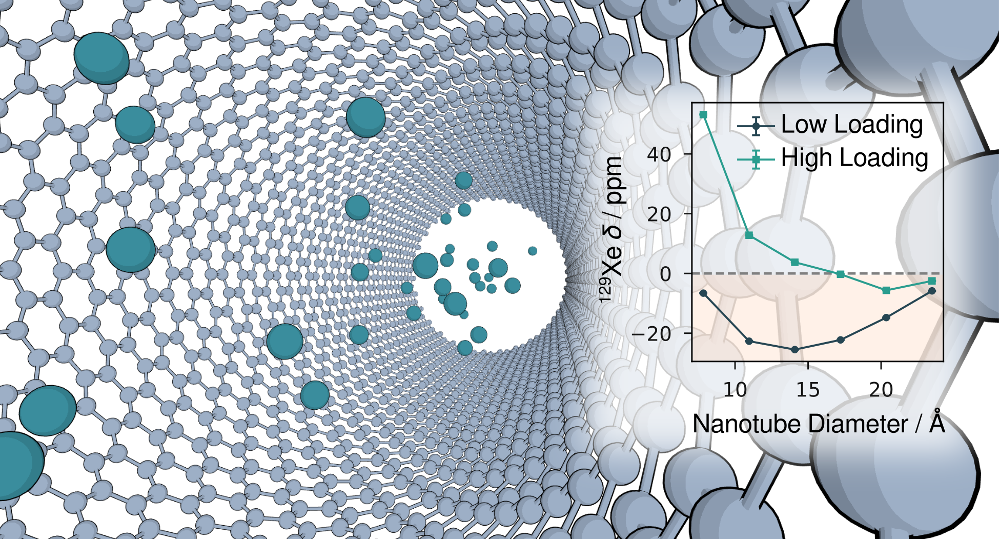

# Supporting Code for “*Carbon Nanotube-Induced Magnetic Shielding Effects on <sup>129</sup>Xe NMR from Equivariant Neural Networks*”

## Graphical Abstract



---

📄 Author: **Ouail Zakary** 
- 📧 Email: [Ouail.Zakary@oulu.fi](mailto:Ouail.Zakary@oulu.fi)  
- 🔗 ORCID: [0000-0002-7793-3306](https://orcid.org/0000-0002-7793-3306)  
- 🌐 Website: [cc.oulu.fi/~nmrwww/members/Ouail_Zakary.html](https://cc.oulu.fi/~nmrwww/members/Ouail_Zakary.html)  
- 📁 Personal Website: [ozakary.github.io](https://ozakary.github.io/)

---

This is the Supporting Code for the manuscript “*Carbon Nanotube-Induced Magnetic Shielding Effects on <sup>129</sup>Xe NMR from Equivariant Neural Networks*”. [](https://doi.org/10.26434/chemrxiv.15007956/v1)

The dataset comprises the following sections:

1. Code for generating CNTs. ([directory](./gen_cnts/))
2. Single-point and <sup>129</sup>Xe NMR parameter calculations using VASP. ([directory](./dft_and_nmr_calculations_vasp/))
3. Procedure for processing and preparing the dataset for fine-tuning MACE-OMAT-0 using MACE.  ([directory](./ft-afm_dataset/))
4. Input files for fine-tuning MACE-OMAT-0 using MACE.  ([directory](./ft-afm_mace/))
5. Code for performing UMAP analysis.   ([directory](./umap_analysis/))
6. Procedure for processing and preparing the dataset for training MatTen.  ([directory](./nmr-ml_dataset/))
7. Input files for training MatTen.  ([directory](./nmr-ml_matten/))
8. LAMMPS MLMD simulation procedure and input scripts. ([directory](./mlmd_procedure_lammps/))
9. Procedure for <sup>129</sup>Xe σ<sub>iso</sub> prediction using the trained NMR-ML model. ([directory](./nmr-ml_predict_procedure/))
10. Python scripts and raw numerical data for all figures included in the main manuscript and the Supporting Information. ([directory](./figures/))

## Citations
If you use the code in this repository, please cite the following:

### Preprint [](https://doi.org/10.26434/chemrxiv.15007956/v1)

```bibtex
@article{zakary_xe-at-cnts_paper_2026,
  title={Carbon Nanotube-Induced Magnetic Shielding Effects on <sup>129</sup>Xe NMR from Equivariant Neural Networks},
  author={Zakary, Ouail and Jacklin, Tiia and Lantto, Perttu},
  journal={ChemRxiv},
  volume={},
  pages={}, 
  year={2026},
  publisher={},
  doi={10.26434/chemrxiv.15007956/v1},
  url={https://doi.org/10.26434/chemrxiv.15007956/v1}
}
```

### Dataset  

```bibtex
@dataset{zakary_xe-at-cnts_data_2026,
  author = {Zakary, Ouail and Jacklin, Tiia and Lantto, Perttu},
  title = {Supporting Data for "Carbon Nanotube-Induced Magnetic Shielding Effects on <sup>129</sup>Xe NMR from Equivariant Neural Networks"},
  year = {2026},
  publisher = {Zenodo},
  doi = {TBA},
  url = {TBA}
}
```

### Code [](https://github.com/ozakary/data-Xe_at_CNTs)
```bibtex
@misc{zakary_xe-at-cnts_code_2026,
  author = {Zakary, Ouail and Jacklin, Tiia and Lantto, Perttu},
  title = {Supporting Code for "Carbon Nanotube-Induced Magnetic Shielding Effects on <sup>129</sup>Xe NMR from Equivariant Neural Networks"},
  year = {2026},
  publisher = {GitHub},
  journal = {GitHub repository},
  howpublished = {\url{https://github.com/ozakary/data-Xe_at_CNTs}},
  url = {https://github.com/ozakary/data-Xe_at_CNTs}
}
```

---
For further details, please refer to the respective folders or contact the author via the provided email.
